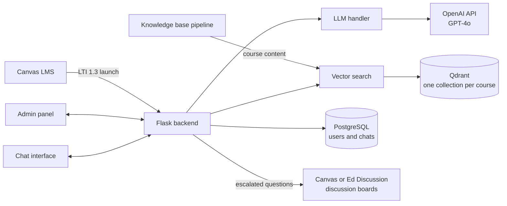
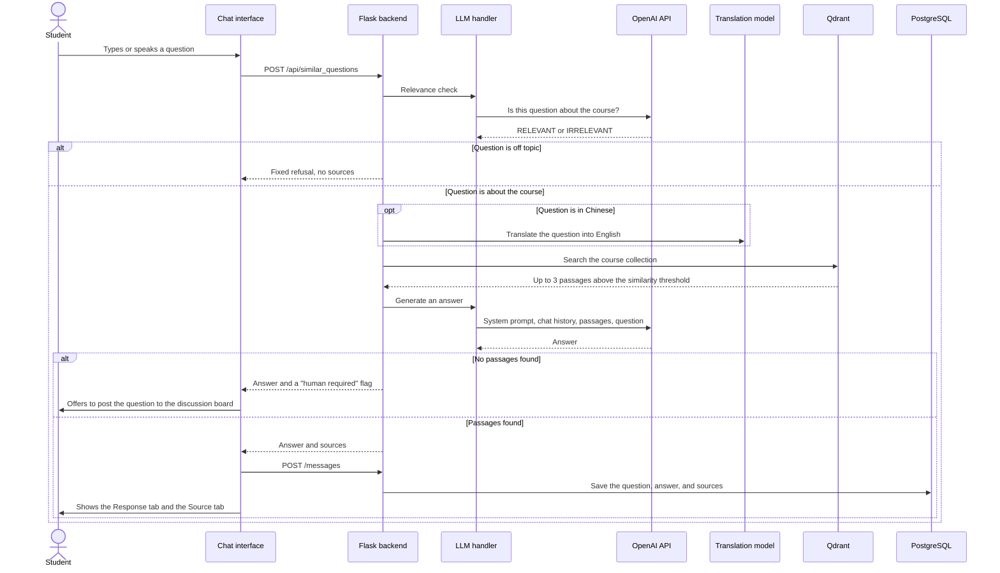

*Adapted from documentation I wrote for AIAG, an AI teaching assistant built at Arizona State University. Some details are simplified.*

# AIAG architecture overview

This page explains how the parts of AIAG fit together and how a student's question becomes an answer. It's for developers who need a working mental model of the system before they change it.

## What AIAG is

AIAG (ASU Instructor Assistant GPT) is an AI teaching assistant for Arizona State University (ASU) courses. Students ask course questions in plain language. AIAG answers from that course's own materials and shows the sources it used. When the course materials don't contain an answer, AIAG offers to post the question to the course discussion board, where the teaching staff can answer it.

AIAG uses retrieval-augmented generation (RAG). Before a large language model (LLM) writes an answer, AIAG retrieves the passages from the course's knowledge base that are most similar to the question and gives them to the model as context. The model answers from those passages instead of from general knowledge.

## Components

| Component | Built with | What it does |
| --- | --- | --- |
| Chat interface | React, Vite, Tailwind CSS | Where students ask questions, read answers and sources, and manage chats. |
| Admin panel | React, ASU Unity Design System | Where instructors connect a Canvas course and choose the materials AIAG can use. |
| Backend | Python, Flask | Handles sign-in, chats, question answering, and escalation. |
| LLM handler | OpenAI API (GPT-4o) | Runs the relevance check and writes answers. |
| Vector search | Qdrant | Finds the passages most similar to a question, one collection per course. |
| Knowledge base pipeline | Python scripts | Pulls, cleans, chunks, and loads course content from Canvas and Ed Discussion. |
| Relational database | PostgreSQL | Stores users, chats, and messages. |
| Language and voice | Local models | Translate Chinese questions for search and transcribe voice input. |

## System overview

Students open AIAG from Canvas, ASU's learning management system (LMS), through Learning Tools Interoperability (LTI) 1.3. Every request goes through the Flask backend, the only component that talks to the databases, OpenAI, and Canvas.

Because each course has its own collection, a question never retrieves another course's materials.

## How a question is answered

The following sequence diagram traces one question from the chat interface to the answer on screen.

Step by step:

1. **The chat interface sends the question,** with the chat history, the course, and the interface language.
2. **The backend identifies the course** from the Canvas launch, or from the course selector outside Canvas.
3. **The relevance check runs first.** Off-topic questions get a fixed refusal and never reach the search or escalation steps.
4. **Chinese questions are translated for search only,** because the course content is indexed in English.
5. **Qdrant returns the closest passages:** up to 3, each with a similarity score above 0.7.
6. **The LLM handler builds the prompt** from a system prompt with the course rules, the chat history, the passages, and the original question. The model answers in the language of the question.
7. **The chat interface shows the result** in a **Response** tab and a **Source** tab, and saves the exchange to the chat history.
8. **If nothing matched, AIAG offers escalation.** The backend still returns the model's reply, plus a flag that tells the chat interface to offer a discussion board post. The model is still called because, with no passages, its system prompt tells it to say it can't answer from the course materials and to point the student to the teaching staff, so the student gets a clear reply in their own language instead of a blank answer.
