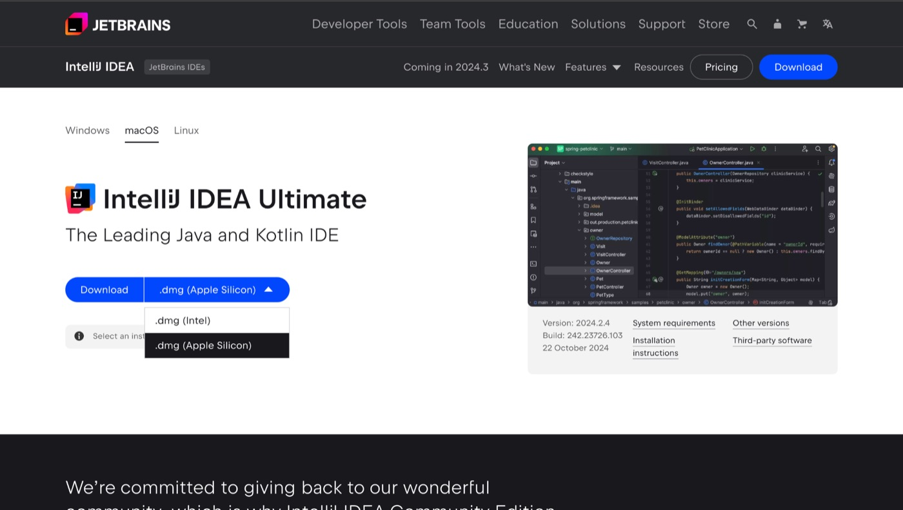
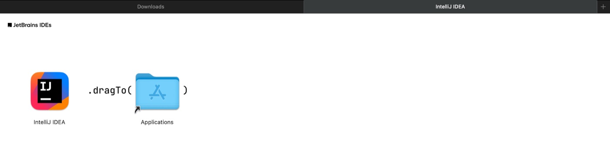
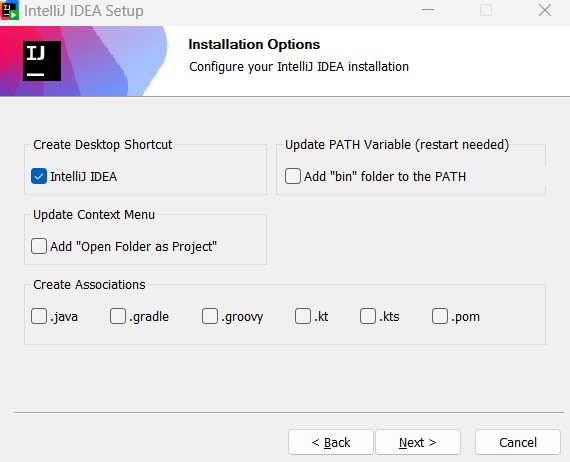
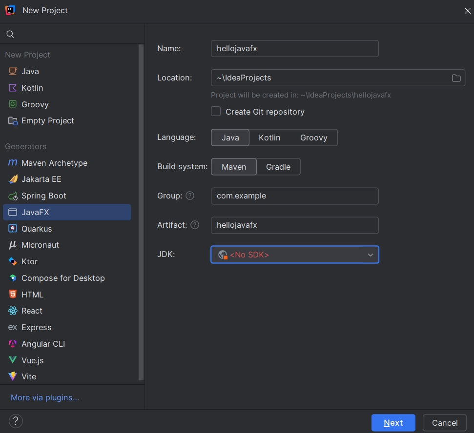
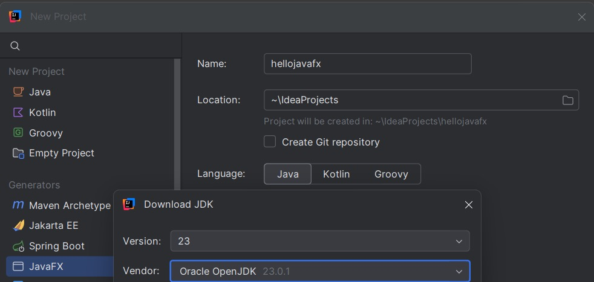
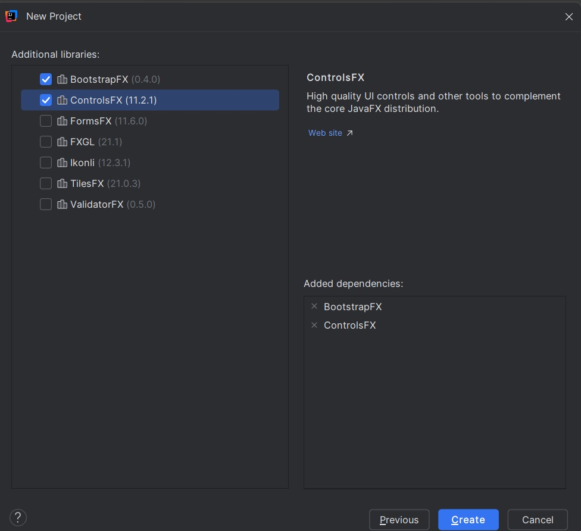
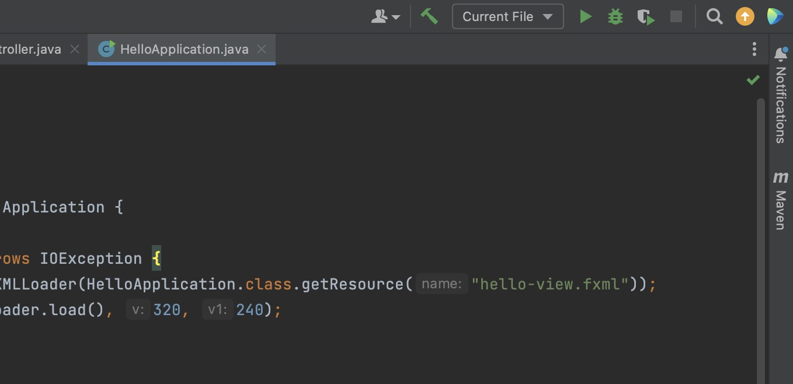
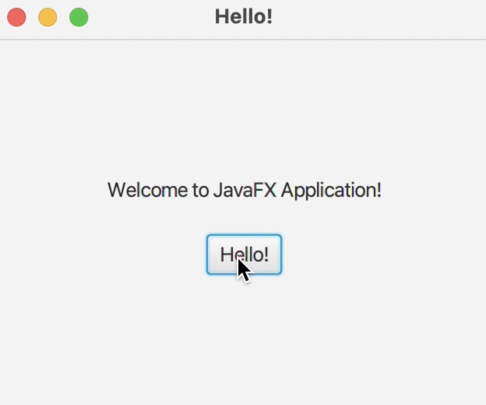

*Condensed from the macOS (7 pages) and Windows (8 pages) setup guides I wrote for CSE 360 at Arizona State University. The screenshots are from the original guides.*

# Installing IntelliJ IDEA and JavaFX

This guide gets IntelliJ IDEA and a working JavaFX project running on your own laptop, before your first assignment. It's for students in Introduction to Software Engineering who haven't set up a Java development environment before. Plan for about 20 minutes, most of it waiting for downloads.

When you finish, you'll have run a sample JavaFX app, which tells you everything is configured correctly.

## Before you start

- **Check your processor.** On a Mac, open the Apple menu and select **About This Mac**. If you see **Chip: Apple M1** (or M2, M3, M4), you have Apple silicon. If you see **Processor: Intel**, you have an Intel Mac. On Windows, most laptops use the standard installer. Use the ARM64 installer only if your laptop has an ARM processor.
- **Use an account that can install apps.** Windows asks for permission during the install.
- **Stay on a reliable connection.** IntelliJ IDEA and the Java Development Kit (JDK) are large downloads.

## Install IntelliJ IDEA

Download **IntelliJ IDEA Community Edition** from the JetBrains download page. Community Edition is free and has everything this course needs.

### macOS

1. On the download page, choose the **.dmg** for your processor: **Apple Silicon** or **Intel**.

2. In your Downloads folder, double-click the .dmg file to open it.
3. Drag the IntelliJ IDEA icon into the **Applications** folder, and wait for the copy to finish.

4. Open **Applications** and double-click **IntelliJ IDEA**. If macOS asks whether you want to open an app downloaded from the internet, select **Open**.

### Windows

1. On the download page, choose **.exe (Windows)**, or **.exe (Windows ARM64)** for an ARM laptop.

. Choose ARM64 only for an ARM processor.")

2. In your Downloads folder, double-click the .exe file. If Windows asks whether to allow the app to make changes, select **Yes**.
3. In the installation wizard, select **Create Desktop Shortcut**, then **Next**.

4. Keep the default install location and select **Install**. IntelliJ IDEA starts when the install finishes.

## Create a JavaFX project

These steps are the same on macOS and Windows.

1. On the **Welcome** screen, select **New Project**.
2. Under **Generators** on the left, select **JavaFX**.
3. In **Name**, enter `hellojavafx`. Change **Location** only if you keep your coursework somewhere else.

4. Next to **JDK**, if no JDK is listed, select **Download JDK**:
    - **Version:** the latest version.
    - **Vendor:** Oracle OpenJDK. On an Apple silicon Mac, choose the build marked **aarch64**.
    - Select **Download**, and wait for it to finish.

5. Select **Next**. Leave the optional libraries cleared unless your assignment asks for one, and select **Create**.

IntelliJ IDEA builds the project structure. When it's done, the project files appear in the **Project** pane on the left.

## Run the sample app

1. Select the green **Run** button (►) at the top right of the window.

2. Wait for the build to finish.

A small window titled **Hello!** appears. Select its **Hello!** button, and the message **Welcome to JavaFX Application!** appears. **If you see that message, your setup is complete.** Close the window and you're ready for the first assignment.

## Troubleshooting

### "JavaFX runtime components are missing"

The project can't find the JavaFX libraries. Add them from Maven:

1. Select **File** > **Project Structure**.
2. Select **Libraries**, then the **+** button, then **From Maven**.
3. Add both of these libraries, one at a time:
    - `org.openjfx:javafx-controls:21.0.1`
    - `org.openjfx:javafx-fxml:21.0.1`
4. Select **Apply**, then **OK**, and run the app again.

### "Module not found"

JavaFX isn't listed as a dependency of your module.

1. Right-click the project folder in the **Project** pane and select **Open Module Settings**.
2. Select **Modules**, then the **Dependencies** tab.
3. Make sure the JavaFX libraries are in the list. If they aren't, add them with the steps in the previous section.

### The app still doesn't start

- Make sure your antivirus software isn't blocking Java applications.
- Update IntelliJ IDEA from **Check for Updates**, then restart it.
- Still stuck? Bring your laptop to office hours, or post the full error message in the course FAQ thread.
